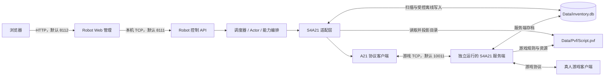

# 仓库功能与服务端接入导读

本文面向第一次接触 `dnf-robot-s4a21` 的读者，说明项目用途、可执行操作、与游戏服务端的关系、首次接入和源码阅读路线，并评估 C# 语言迁移与 SQLite / MySQL 选型。

核对日期：2026-10-13；Robot 仓库核对基线：`6cc0e53`（前序业务源码基线为 `1a3ecd4`，后续提交补入本文）。本文依据当前代码和仓库文档整理；第 8.4、12、13 节还只读核对了本机相邻 `S4A21Server` 仓库的相关源码，服务端基线为 `6bd5197`。本次没有启动 Robot、连接游戏服务端或修改游戏数据库；文中实机验证信息来自已有 [S4A21 能力状态](S4A21能力状态.md) 和跟随记录，不代表本次重新验证，也不证明这两个源码版本已完成配套联调。

## 1. 这个项目主要做什么

这是一个用 Go 编写的 DNF 假人管理程序。它替机器人角色建立游戏协议连接，并通过 Web 控制台和自动调度，让这些角色上线、在城镇活动、喊话、接受组队邀请，以及开分解机或附魔摊。

典型用途是：维持一定数量的假人在线，让城镇分布更多角色，产生区域聊天和物品公告，并提供副职业摊位。它也可以作为登录、城镇和组队协议的观察对象，但当前能力不覆盖自动战斗和完整副本流程。

游戏服务端独立运行，负责账号、角色、世界状态和规则判定；Robot 作为协议客户端接入。Robot 的 Web、控制 API、调度器和适配器运行在同一个进程里，无需额外安装 Web 前端服务。

当前注册表只提供一个适配端：**S4A21，内部 ID 为 `sim_a21`**。虽然代码有通用适配架构，也不能据此认为它能直接连接任意 DNF 服务端。

源码依据：[适配器注册表](../internal/composition/backend/registry.go)、[能力描述](../internal/composition/backend/s4a21/descriptor.go)、[进程装配](../cmd/robot/runtime_main.go)。

## 2. 能做哪些操作

以下以当前 S4A21 适配端为准。接口名表示代码提供的入口；最终执行结果仍取决于服务端响应。

| 功能 | 能执行的操作 | 入口与边界 |
| --- | --- | --- |
| 创建与认领 | 按名字、职业、等级和装备配置创建角色；启动时认领符合规则的已有 Robot 角色 | `createRobots`；自动调度也会补齐角色缺口 |
| 在线管理 | 指定角色上线、保活、下线；异常连接恢复 | Web「上线 / 下线」；`robotsOnlineAsync`、`robotsLogoutAsync` |
| 自动调度 | 按目标在线数安排上线和缩容，结合连接压力、错误与熔断调节速度 | Web「自动」；`autoStart`、`autoStop` |
| 城镇活动 | 城镇内移动、区域切换、分散出生 | Web「移动」；`robotsMove`；不提供副本房间移动 |
| 区域喊话 | 普通区域聊天，按模板和间隔自动发送 | Web「喊话」；`robotsShout`、`robotsShoutLocal`；世界喊话不支持 |
| 角色外观与属性 | 初始化等级、经验、成长、装备、装扮、宠物及宠物装备 | 创建配置与适配层离线持久化；部分成长显示仍待实机确认 |
| 组队 | 自动接受真人邀请，在城镇跟随队长位置和区域，离队后恢复普通调度 | 会话自动处理；不主动建队或邀请，不实现战斗、技能、结算 |
| 工会 | 自动接受工会邀请 | 会话自动处理；完整工会管理不支持 |
| 副职业摊位 | 自动或手动开分解机、附魔摊，到期关闭并恢复普通活动 | `robotsStore`、`robotsStoreAsync`；个人物品商店不支持 |
| 物品公告 | 通过开箱或强化触发服务端物品广播，自动模式按分区限流 | `robotsServerNotice`；不是任意文本全服公告，客户端显示有分区条件 |
| 状态与统计 | 查看角色、Actor、在线目标、调度、资源、游戏端口、数据库状态和人口报告 | Web 概览 / 统计；`dashboardStatus`、`robotsStatus`、`populationReport` |
| 配置管理 | 设置服务端连接参数、自动策略，读取和更新机器人配置 | `GET/POST /api/backend`；`robotConfigGet`、`robotConfigUpdate` |
| 角色清理 | 通过游戏协议删除指定 Robot 角色，并清理对应登记 | Web「清理」；`cleanupRobotsAsync`；会删除数据 |
| 危险删除 | 按 UID、CID 或范围彻底清除适配层认定的 Robot 数据 | Web 顶部「删除」；需解锁，走 SQLite 清除流程 |
| 停止程序 | 停止新工作，完成有界收尾，保存必要状态并退出 Robot | Web 顶部「停止」；`POST /api/stop-robot`；不会代替服务端关服 |

必须区分三个动作：**下线**释放会话；**清理**删除角色；**危险删除**进一步清除指定 Robot 账号 / 角色数据。调整在线人数通常用目标在线数或下线，不需要删角色。

当前不支持拍卖行、金币寄售、个人物品商店、邮件通知轮询、自由文本全服公告、世界喇叭、主动副本移动、技能释放、战斗结算和服务端启停。通用架构文档中的能力分组包含扩展方向，实际支持范围看适配器能力矩阵。源码中存在某个 opcode 常量或 API 路由，也不等于该能力可以使用。

已有能力文档记录了分解机和附魔摊在 Windows 环境的开店验证，以及城镇跟随等验证。真人使用附魔摊的结算、耐久耗尽后的补充、部分成长显示及 Linux 完整运行周期仍有未验证项，详见 [能力状态](S4A21能力状态.md)。

## 3. 怎么与服务端关联

### 3.1 整体链路



Robot 控制 API 与游戏协议是两套不同协议。浏览器提交的 JSON 会由 Web 转成 `<tw>...</tw>` 控制帧；游戏服务端收到的是 S4A21 二进制游戏包。

真人客户端与 Robot 各自连接游戏服务端。Robot 不需要操作真人客户端窗口；城镇角色、聊天或摊位能否被真人看见，由服务端投影和客户端渲染决定。

### 3.2 三个关联面

| 关联面 | Robot 依赖什么 | 关联程度与实际影响 |
| --- | --- | --- |
| 游戏协议 | 登录、选角、角色创建 / 删除、城镇、聊天、组队、副职业等 A21 包格式和回执 | 强关联。只有端口能连通不能证明协议兼容；包字段或服务端处理改变后需要核对适配层 |
| 游戏存档 | 与服务端实际使用的同一份 SQLite 数据库及其 schema、二进制物品编码 | 强关联。Robot 会读写 Robot 账号数据；指向数据库副本会导致创建结果与初始化数据不一致 |
| PVF | 当前服务端使用的职业、等级经验、装备、地图、任务门禁和副职业配置 | 强关联。目录内容影响角色创建、装备选择、成长计算、出生位置和行为资格 |

公共调度、Actor、Web 通过统一契约表达「上线」「移动」等意图。协议 opcode、数据库表结构和版本规则集中在 `internal/composition/backend/s4a21/` 与 `internal/protocol/s4a21/`，便于以后替换适配端。

**实际部署需要游戏地址可达、PVF 可读、同一份游戏数据库可访问且可写。** 当前没有通过远程 HTTP 服务读写游戏存档的实现，因此只填一个远程游戏 IP 不足以完成接入。初次部署以 Robot 与 S4A21 服务端位于同一台 Windows 主机的布局最容易核对。其他布局需要另外确认文件访问、SQLite 锁和路径一致性，本文没有验证这些组合。

### 3.3 默认端口的分工

| 默认值 | 所属进程与作用 | 使用方式 |
| --- | --- | --- |
| `8112` | Robot Web 管理端口 | 浏览器打开 `http://127.0.0.1:8112/` |
| `8111` | Robot TCP 控制端口 | Web 内部代理或本地工具向它发控制命令 |
| `10011` | S4A21 游戏协议端口 | Robot 会话连接此端口；以服务端实际监听值为准 |

8111 和 8112 在源码中监听 `0.0.0.0`。控制 TCP 没有通用登录鉴权，Web 默认口令为 `twadmin`，部署时要按现有 [构建与发布](构建与发布.md) 的要求修改口令并限制端口来源。这与游戏账号登录是不同的认证边界。

组队会话还会注册本地 UDP 端点并处理 TQOS 传输应答。这只是协议兼容的一部分，不能据此认为 Robot 已实现副本内位置同步。

## 4. 服务端路径怎样填写

Web 顶部「服务端」弹窗提供以下设置，并保存到 Robot 自有的 `config/state/backend_selection.json`：

| 设置键 | 界面含义 | 初次接入示例 |
| --- | --- | --- |
| `server_directory` | 服务端目录，必填；包含服务端程序和 `Data` | `D:\ServerS4A21`，替换为实际绝对路径 |
| `server_host` | 游戏地址，必填 | 同机通常为 `127.0.0.1` |
| `game_port` | 游戏 TCP 端口，必填 | 默认 `10011`，与服务端监听值一致 |
| `database_path` | SQLite 路径覆盖，可选 | 常规布局留空；覆盖时使用实际数据库的绝对路径 |

这组设置会映射到运行期连接配置。日常通过服务端弹窗修改，避免只改主 INI 的游戏参数却被已保存的适配端设置覆盖。

### 4.1 PVF 的解析顺序

源码 `resolvePVFPath` 按以下顺序寻找可用文件：

1. Robot 进程环境变量 `PVF_ARCHIVE_PATH` 指向的有效文件；相对路径以服务端目录为基准。
2. `服务端目录/Data/Pvf/Script.pvf`。
3. `服务端目录/Data/Pvf/` 中找到的第一个 `.pvf`。
4. 服务端目录中的第一个 `.pvf`。

环境覆盖不存在有效文件时仍会继续尝试后续位置。目录有多个 PVF 时，要通过启动日志 `S4A21_PVF_RESOLVED` 确认实际选中了哪一个。Robot 会把所需目录导出到自身 `config/pvf/`，该目录不是服务端原始 PVF 的默认存放位置。

### 4.2 数据库的解析顺序

1. 非空的适配端 `database_path` 设置。
2. Robot 进程环境变量 `INVENTORY_DATABASE_PATH`；相对路径以服务端目录为基准。
3. `服务端目录/Data/inventory.db`。

显式设置或环境覆盖指向不存在的数据库时会报错，不会自动退回默认数据库。显式 `database_path` 不会由这一解析函数拼接服务端目录，因此建议填绝对路径。

启动日志 `S4A21_DATABASE_RESOLVED` 会输出实际路径和来源。如果 Robot 的覆盖路径与服务端进程环境变量指向不同文件，双方可能使用不同存档；Robot 的路径解析并不会修改服务端进程环境。

源码依据：[路径解析与运行装配](../internal/composition/backend/s4a21/runtime_assembly.go)、[设置映射](../cmd/robot/backend_settings.go)。

## 5. 初始化时会发生什么

启动流程为：

```text
读取主配置、适配端设置
  → 准备 Robot 自有运行目录与默认配置
  → 读取 PVF，生成装备、地图、职业、经验和任务目录
  → 扫描并清理不符合规则的 Robot 账号
  → 对账转职 / 觉醒、任务门禁、装备
  → 建立内存角色目录与身份映射
  → 装配游戏会话、创建器、清理器与统计组件
  → 启动 Robot 控制 TCP 和 Web
  → 自动调度驱动角色活动
```

**初始化包含数据库写入和删除，关闭自动调度也不会取消这些初始化步骤。** `ComposeRuntime` 会调用 `ScanAndClean`、`ReconcileRobotGrowth`、`SeedRobotQuestGates` 和 `ReconcileRobotLoadouts`。

启动认领范围有明确限制：当前装配前缀是 `robot`，账号名必须严格等于 `robot` 加 UID，UID 必须位于配置的 `robot_uid_start..robot_uid_end`。例如默认范围内的 `robot17000000`。只有一个完整、可用且符合配置的角色才会被认领；角色数量、删除状态、等级、职业、成长或装备窗口不符合规则的账号会成为整账号删除候选，并在短事务里重新核对后删除。具体判定见 [启动扫描](../internal/composition/backend/s4a21/startup_inventory.go)。

首次接入前应确认该命名和 UID 段没有用于真人账号，并准备可恢复的服务端存档备份。调整等级、职业或装备窗口也可能改变下次初始化的清理结果。

在线动作优先走游戏协议。确实需要数据库准备的等级、装备、副职业耐久、公告库存等操作放在适配层；影响服务端角色缓存的写入需要在相应角色离线后完成，再重新登录加载。A21 当前把会话关闭作为角色缓存边界。详见 [数据库边界](数据库边界.md)。

### 5.1 假人是固定存档，还是每次上线随机生成

**正常上下线复用服务端数据库中的账号和角色，不会每次重新随机建角。** 名字、职业、等级和装备等在创建时按配置生成并持久化；重新登录时使用原账号和原角色槽位。

| 场景 | 是否复用已有角色 | 哪些内容可能变化 |
| --- | --- | --- |
| 首次创建 | 没有可复用角色时创建并落库 | 名字、职业、成长、等级、装备、装扮、宠物按创建规则生成 |
| 下线后再次上线 | 复用原账号和角色 | 新建网络会话；出生位置可能按固定出生、跟随账号或区域均衡规则调整 |
| 重启 Robot | 扫描数据库，认领符合规则的已有假人 | 初始化可能对账成长、装备和任务门禁；不承诺角色属性永久不变 |
| 降低目标在线数 | 保留存档，只减少在线角色 | 在线角色集合、Actor 分配和运行状态变化 |
| 提高目标在线数 | 优先使用已有可用角色，不足才补建 | 缺口部分新增角色；不会为了每次上线更换名字而重建 |
| 清理、危险删除，或初始化判定不合规 | 可能删除原角色或账号，之后再补建 | 后续新建角色的 CID、名字、装备等可能与原来不同 |

例如数据库中已有 20 名合规假人，把在线目标从 20 降到 10，通常只是减少在线人数，仍保留这 20 名角色；恢复到 20 时复用已有角色。提高到 30，在没有其他可用角色且创建条件满足时，才需要补建缺少的 10 名。

注意区分身份：Robot UID 是配置段中的机器人标识，CID 是服务端角色 ID；游戏会话使用的短 UID 和 Actor 槽位属于运行期标识，不能要求它们每次登录都相同。账号 UID 的数字可能在删除后被重新利用，因此判断是不是原角色还要看 CID。

这是一套可重复使用的角色池，但不是不可变存档。修改等级、职业、成长或装备窗口，可能使原有角色在下次初始化时不合规；进入第 5 节的清理流程后，补建的角色可能发生变化。

源码依据：[普通登录只做登录与选角](../internal/composition/backend/s4a21/session.go)、[创建时复用单角色账号](../internal/composition/backend/s4a21/provision.go)、[启动认领与清理](../internal/composition/backend/s4a21/startup_inventory.go)、[缺口补建](../internal/scheduler/supervisor_scaling.go)、[创建 UID 分配](../internal/composition/backend/s4a21/creator.go)。

## 6. 第一次如何接入

### 6.1 先确认运行平台

当前分发形态**只允许运行于 Windows**。入口 `ensureWindowsRuntime` 会拒绝普通 Linux 启动，即使适配器声明支持 Linux，或者 Linux 二进制编译成功，也不代表本版本可在 Ubuntu 上运行。

Ubuntu 可以用于源码阅读、测试和交叉编译。本文不修改入口限制，也不以移除限制作为接入步骤。

工具链以当前 `go.mod` 为准：`go 1.26.0`、`toolchain go1.26.6`；发布构建按已有发布文档使用 Go 1.26.6 或更新版本。

在本仓库 Ubuntu 环境交叉编译 Windows 可执行文件：

```bash
cd /work/work_new/dof/dnf-robot-s4a21
go version
mkdir -p deploy/output
CGO_ENABLED=0 GOOS=windows GOARCH=amd64 \
  go build -trimpath -buildvcs=false -o deploy/output/robot.exe ./cmd/robot
```

上述命令是操作说明，本次没有执行构建。Windows 本机也可在 cmd 中运行仓库现有脚本：

```bat
deploy\build-robot.bat
```

脚本会输出 Windows 和 Linux amd64 二进制到 `deploy/output/`；Linux 产物仍受入口限制。

### 6.2 首次连接步骤

1. 先准备并启动匹配的 S4A21 服务端，确认真人客户端能登录、选角并进入城镇。Robot 不负责启动或修复游戏服务端。
2. 核对服务端实际游戏地址、端口、PVF 和数据库路径，确认 Robot 能访问它们；核对 Robot 账号命名与 UID 段并备份存档。
3. 把 `robot.exe` 放到固定的 Windows 安装目录，在 cmd 中运行 `robot.exe`。运行目录以可执行文件位置为基准，不以当前命令行目录为基准。
4. 首次未配置适配端时，程序进入恢复 / 设置 Web。浏览器打开 `http://127.0.0.1:8112/`，默认口令为 `twadmin`，已有安装以现有配置为准。
5. 在「服务端」弹窗填入上一节的连接设置并应用。程序结束当前周期、重新装配；正常首次初始化默认启用自动动作，目标在线数为 20。
6. 查看游戏端口、数据库、调度状态和角色列表，核对日志中的 PVF / 数据库实际路径。对小规模接入先把目标人数调低，再逐项观察上线、移动和喊话。
7. 使用真人客户端进入相同城镇和区域，检查角色是否可见、聊天是否出现，再检查邀请入队与城镇跟随。分解机、附魔摊与物品公告分别验收，不能用「上线成功」代替所有能力验收。
8. 完成基本检查后再提高在线目标；缩容用在线目标或下线，退出用 Web「停止」。

首次在 Web 应用服务端设置就会生成非零设置代次；缺少已应用标记时同样触发运行文件重置。因此，不要依靠「先放入一份关闭自动动作的 INI」来保证首次接入不会自动上线。

适配端设置代次变化会备份并重建 Robot 运行期文件，包括 `robot_config.ini`、模板、PVF 导出、状态和日志；主 `config.ini` 保留。备份位置为可执行文件同级的 `config.backend-bak.<UTC时间戳>/`，保留最近 3 份。应用设置后重新核对自动策略，详见 [构建与发布](构建与发布.md)。

### 6.3 Robot 自有目录

```text
安装目录/
├─ robot.exe
└─ config/
   ├─ conf/
   │  ├─ config.ini                 Web 口令、Robot 管理端口等主配置
   │  └─ robot_config.ini           创建、出生、装备和自动策略
   ├─ templates/                   角色名与喊话模板
   ├─ pvf/                         从服务端 PVF 投影出的目录 JSON
   ├─ state/                       适配端选择、代次标记、摆摊点缓存
   ├─ logs/robot.log               运行日志，按配置轮转
   └─ tmp/                         临时文件
```

游戏角色的持久身份来源是服务端数据库；Robot 自有 `state/` 保存设置和部分运行辅助状态，不能用它代替游戏存档。

## 7. 哪些配置最先看

| 文件 / 配置段 | 主要内容 | 当前默认或使用要点 |
| --- | --- | --- |
| `config/conf/config.ini` | Web 认证、8111 / 8112 等管理端口、日志限制 | 首次部署修改 Web 口令；不要混淆管理端口和游戏端口 |
| `config/state/backend_selection.json` | 适配端及服务目录、游戏地址、数据库设置 | 通常由 Web「服务端」弹窗维护 |
| `robot_config.ini` 的 `[create]` | 等级、职业、觉醒档位、UID 段 | 等级 50–85；UID 17000000–17009999；改变窗口会影响启动清理 |
| `[spawn]` | 固定或分散出生，城镇、区域、坐标 | 默认 `spawn_fixed=false`；地图和区域必须符合当前 PVF |
| `[online]` | 在线容量和每次命令上限 | 两项默认 10000；容量上限不等于实测可承载 10000 人 |
| `[equipment]`、`[avatar]`、`[pet]` | 装备品质、强化、套装、装扮和宠物选择 | 候选物品来自当前 PVF，并过滤职业等条件 |
| `[auto]` | 自动开关、目标在线数、聊天间隔及其他自动动作 | 默认自动开启、目标 20、喊话间隔 45–120 秒 |
| `[store]` 及自动摆摊项 | 分解 / 附魔分配和摆摊策略 | `store_enchant_ratio_percent` 默认 30；部分默认值由 Go 配置逻辑补齐 |
| 公告调度项 | 开箱 / 强化触发比例、机器人间隔、分区限制和限流 | 自动物品公告默认关闭；通过 `server_notice_*` 等配置控制 |
| `templates/robot_name_templates.json` | 角色名规则 | 字符编码和长度还需符合服务端协议 |
| `templates/robot_shout_templates.json` | 喊话内容 | 与区域喊话开关、间隔共同生效 |

表中首次释放文件的数值来自 [默认机器人 INI](../internal/bootstrap/runtime/defaults/robot_config.ini)，未显式写入的项由 Go 配置逻辑补齐。不要把精简默认 INI 当作所有配置项的完整清单；某些项在文件缺失时的 Go 缺省值与已释放 INI 的值不同。配置结构、缺省值、加载和校验集中在 [robotconfig](../internal/capability/robotconfig/runtime_config.go)，缺省值见 [defaults.go](../internal/capability/robotconfig/defaults.go)。Web 控件和接口对照见 [Web 交互清单](Web交互清单.md)。

## 8. 看懂一次操作的完整流程

### 8.1 Web 点击「上线」

```text
浏览器提交 POST /api/call
  command = robotsOnlineAsync，payload = {uids: 所选 UID 列表}
  → webadmin.handleCall / callRobot
  → 本机 8111：<tw><c>robotsOnlineAsync</c><json>...</json></tw>
  → tcpapi.HandlePacket → handleRobotCommand → queueRobotAction
  → RobotManager.OnlineManaged
  → 绑定 Actor，发送 CommandOnline
  → RobotRuntime.OnlineNoConfirm → SessionService.Online
  → sessionActionEnv.SendOnline → protocolSessionDriver.SendOnline
  → ActionTransport.Open → SessionFactory.OpenSession
  → Dial 游戏端口 → LOGIN → SELECT_CHARACTER → CHECK_CONNECTION
  → 初始化城镇位置，启动接收 / 保活及可用的邀请处理
  → 统一运行状态投影 → Web 刷新展示
```

`robotsOnlineAsync` 返回 `queued` 表示任务已入队；返回 `running` 也不表示角色已经登录成功。应继续查看 `operationStatus`、`robotsStatus` 和最终确认计数。游戏端口显示可连通，只证明 TCP 探测通过。

源码定位：[Web 代理](../internal/entry/webadmin/robot_proxy.go)、[TCP 命令](../internal/entry/tcpapi/robot_commands.go)、[受管操作](../internal/scheduler/commands.go)、[Actor 运行端口](../internal/scheduler/actor_runtime.go)、[会话驱动](../internal/scheduler/backend_ports.go)、[会话建立](../internal/composition/backend/s4a21/session.go)。

### 8.2 创建一名角色

```text
createRobots {count: 1}，或自动调度发现角色缺口
  → RobotManager.CreateRobots
  → S4A21 RobotCreator 规划 UID、名字、职业、等级和出生位置
  → Provisioner 登录账号，读取角色列表
  → 可复用的单角色账号认领，或检查名字并发送创建角色包
  → 关闭临时协议连接
  → 适配层离线初始化等级、经验、成长、属性、装备与任务门禁
  → 注册 Robot 角色与身份映射
  → 后续上线时由服务端读取存档并投影给客户端
```

因此创建结果由「游戏协议创建」与「离线存档初始化」共同完成。数据库 schema 不兼容、PVF 不匹配或身份登记失败时，不能只凭创建包成功就认为整个初始化完成。

源码定位：[创建器](../internal/composition/backend/s4a21/creator.go)、[协议建角](../internal/composition/backend/s4a21/provision.go)、[角色初始化](../internal/composition/backend/s4a21/loadout.go)。

### 8.3 常见游戏包对应关系

| 业务动作 | 当前协议命令 | 代码值 |
| --- | --- | --- |
| 登录 | `CmdLogin` | `0x0001` |
| 选角 | `CmdSelectCharacter` | `0x0004` |
| 建角 / 删角 | `CmdCreateCharacter` / `CmdDeleteCharacter` | `0x0005` / `0x0006` |
| 区域消息 | `CmdSendMessage` | `0x0011` |
| 城镇位置 / 区域 | `CmdSetUserPosition` / `CmdSetUserArea` | `0x0023` / `0x0024` |
| 开 / 关副职业摊 | `CmdCreateExpertJobStore` / `CmdCloseExpertJobStore` | `0x0257` / `0x0259` |
| 保活 | `CmdCheckConnection` | `0x04DD` |

这些值只描述本仓库实现，来源是 [协议 codec](../internal/protocol/s4a21/codec.go)。给其他版本接入时，还要核对帧结构、字段编码、通知和服务端处理，不能仅替换 opcode。

### 8.4 如果要组队进入副本战斗，还缺少什么

**当前完成的是接受邀请和城镇跟随；还没有完整的副本运行与战斗链路。** `dungeon_follow` 能力名、`EnableDungeonFollower` 函数名和现有副本发包函数都不能作为「已支持副本战斗」的依据。

本节先以「真人队长邀请一名假人，由真人选择普通副本，假人作为队员参与」为最小观察范围。假人自己建队、邀请、选本是更进一步的自主队长能力；不是实现真人带队的必需前提。普通副本也不能代表塔、安徒恩或其他特殊玩法。

#### 8.4.1 已有的基础可以复用

| 已有内容 | 当前完成到哪里 | 仍需区分的边界 |
| --- | --- | --- |
| 登录、队伍身份和邀请处理 | 注册 UDP 端点，接受普通邀请，维护队伍与队长身份 | 运行期处理限于邀请、队伍通知、城镇位置 / 区域；没有接收进房后启动战斗的状态机 |
| 教程准备 | 通过协议设置教程跳过标记，并处理回执与有限重试 | 不代表所有副本准入条件满足 |
| 任务门禁 | 离线补齐当前 PVF 中相关完成 / 进行中任务集合 | 等级、门票、次数、权限等仍由服务端校验；机器人没有完整任务推进业务 |
| 副本协议原语 | `EnterSelectDungeon`、`SelectDungeon`、`FinishLoading`、`MoveMap` 有发送实现 | 当前生产会话没有调用这些方法；存在原语不等于业务链路完整 |
| 协议探针 | `TestLivePartyDungeonFollowerProjectionProbe` 有两会话入图、加载和换房观察流程 | 是显式启用的实机测试，会创建账号 / 角色并操作服务端；本次未运行，不是已上线的 Robot 能力 |
| 技能目录 | 公共层有 PVF 技能状态提取与技能目录匹配代码 | 不是副本战斗执行器；S4A21 没有开放 `skill` 能力 |
| 服务端副本基础 | 当前相邻服务端有入图、共享房间、加载屏障、击杀、结算和返回城镇处理 | 只能证明源码存在；Robot 配套协议和真人客户端表现仍需验证 |

Robot 侧依据：[follower 工作流](../internal/composition/backend/s4a21/dungeon_follower.go)、[会话通知分发](../internal/composition/backend/s4a21/session.go)、[协议原语](../internal/protocol/s4a21/client.go)、[实机探针源码](../internal/protocol/s4a21/party_live_test.go)、[技能目录提取](../internal/capability/pvf/pvf_skill.go)、[能力描述](../internal/composition/backend/s4a21/descriptor.go)。

#### 8.4.2 主要缺口

| 环节 | 需要补齐或验证什么 | 主要涉及哪里 |
| --- | --- | --- |
| 副本状态管理 | 从城镇 / 入队进入选本、加载、房间活动、结算、返回城镇；跟踪当前会话和房间代次，丢弃旧事件 | S4A21 会话与公共状态投影；不能另建与统一状态表竞争的状态源 |
| 选本与准入反馈 | 消费队长选本后的队员投影，处理拒绝原因、队伍变化和取消；核对所有队员的准入资格 | Robot 适配层与服务端 `DungeonEntryHandler`；真人带队时不能让每个假人独立发选本请求 |
| 入图与加载屏障 | 解析 `START_MAP` 等实际通知，建立房间信息，在准备完成后调用 `FinishLoading`，等待服务端放行 | Robot 会话与服务端 `DungeonLoadingCoordinator`；缺少队员 ready 可能使全队等待或触发加载超时 |
| 房间与实体数据 | 建立当前房间、地图、出生点、怪物 / 对象序号和事件快照；处理动态生成、死亡与换房 | Robot 的版本数据解析；数据必须来自实际通知和匹配 PVF，不能猜怪物编号 |
| 副本内位置与动作同步 | 在已证实的直连或中继路径上收发应用层位置、朝向、动作等负载，让真人客户端消费并显示 | Robot UDP 应用层、服务端 peer / relay 和真人客户端；现有 TQOS 应答仅证明传输协商 |
| 最小战斗行为 | 对一个职业验证寻敌、接近、普通攻击或一种技能、冷却和资源处理、受击 / 死亡；之后再扩展策略 | Robot 能力编排与适配器；技能名称或状态目录本身不会触发攻击 |
| 战斗事实与同步 | 核对技能动作、命中、伤害、怪物死亡的实际生成者和接收者，正确关联当前房间 actor，并避免重复上报 | 当前客户端数据面与服务端击杀链；不能把随意发送死亡包当成战斗实现 |
| 换房与地图推进 | 跟随队长的有效换房投影，更新房间代次，再次完成加载；若假人做队长，还需验证开门条件与路线 | Robot 会话与服务端房间状态；不能在未清房或旧房间状态上强行换图 |
| 结算与返回 | 消费通关、结果、奖励 / 翻牌等当前流程，处理放弃、退出、返回城镇并恢复普通调度 | Robot 适配层与服务端结算 / 城镇返回处理；不能靠重登假装完成通关 |
| 异常与调度隔离 | 处理队长断线、踢人、全队死亡、加载失败、超时与重连；副本期间禁止城镇活动和离线补货重登抢占 | Actor / scheduler / 会话；现有 `PartyActive` 保护可复用，但还不等于完整副本收尾 |
| 能力和验收 | 真实流程完成后才开放能力、投影 Web 状态并更新能力矩阵；普通副本与特殊玩法分别验收 | descriptor、统一状态、Web 和能力文档；本次没有改变这些能力开关 |

服务端已经实现队伍共享加载屏障：各参与者提交 ready 后才释放，源码中还设有 45 秒加载超时。因此最先补齐的不是技能按钮，而是 Robot 队员能正确处理入图与加载完成，否则真人队长可能在加载阶段等待。

服务端 `DungeonCombatHandler.HandleDieMonster` 把收到的怪物死亡报告交给 `DungeonKillApplicationService`，按当前实例 / 房间和 actor 身份处理共享死亡事实及各参与者效果。技能注册部分主要处理加点、技能栏和配置，不能把 `USE_SKILL` 枚举存在理解为「发一个技能 ID，服务端就自动模拟一次完整战斗」。实际动作、伤害与死亡的线路和责任划分还要由当前客户端抓包 / 逆向确认。

#### 8.4.3 历史阻塞与当前服务端的区别

已有 [组队与跟随记录](优化与跟随规划.md) 的 2026-09-28 结论是：当时环境的客户端不处理队员 UDP 位置帧，服务端城镇投影又排除副本内玩家，所以放弃副本内跟随并移除了相关应用层实现。当前 Robot 的 `party_udp.go` 仍只处理 TQOS 控制帧，不解析或发送副本位置应用负载。

本次核对的相邻服务端版本则存在 `PartyUdpRelay`，并由 `DFO_UDP_RELAY` 控制，缺省关闭；其作用是转发客户端之间的 UDP 数据报。**中继存在不等于 Robot 已有动作协议，也不等于真人客户端已能显示动作。** 旧结论描述旧环境，不能据此断言新组合必然失败；当前中继源码也不能证明旧问题已经修复。

恢复开发前，需要在实际部署的服务端和真人客户端组合上验证三件事：成员端点是否正确投影、应用负载是否到达、客户端是否消费并显示。在这些条件证实前，不应只恢复旧 UDP 发包代码，也不应通过数据库直接扣怪物血量或写通关奖励来替代缺失的战斗链路。

#### 8.4.4 建议的落地顺序与验收点

以下是后续工作建议，不是本次已批准或已完成的实现计划：

1. **真人队长 + 一名假人，只验证入图、加载和退出。** 复用邀请与教程准备、现有发包原语和探针流程；成功标准是双方收到匹配的房间投影、加载屏障正确释放、假人能返回城镇。此阶段不声称会战斗。
2. **验证一个普通房间内的位置与动作显示。** 对实际直连 / 中继链路取证，先证明真人能看到假人正确移动，再接换房；以客户端画面与同时间抓包对应，而非仅看发送计数。
3. **实现一个职业的一种基础攻击。** 核对目标 actor、动作、命中 / 伤害与死亡来源；验收真人可见、服务端状态一致、重复事件不产生重复奖励。
4. **打通单个普通副本的结算与回城，再扩展。** 覆盖队长退出、假人断线、加载超时与死亡后的恢复；之后再评估多职业、多假人和特殊副本。

若目标升级为「假人自己组队并自动刷图」，还需补主动建队 / 邀请、队伍成员选择、队长选本、路线与开门策略等能力。现有 `SetPartyInfo` 和 `RequestPeer` 只能作为待接入原语，不能直接视为完成自主组队。

#### 8.4.5 本次核对的服务端源码位置

以下路径相对于本机相邻的 `S4A21Server` 仓库，用作服务端证据定位；它们不是本 Robot 仓库的必备文件：

| 服务端路径 | 本次核对内容 |
| --- | --- |
| `Server/DfoServer/Network/Protocol/GameProtocolHandler.cs` | 副本、技能和其他协议处理注册边界 |
| `Server/DfoServer/Network/Handlers/Dungeon/DungeonEntryHandler.cs` | 选本投影、队员与队长角色区别 |
| `Server/DfoServer/Network/Handlers/Dungeon/DungeonLoadingCoordinator.cs` | 共享 ready 屏障、加载完成通知与超时 |
| `Server/DfoServer/Network/Handlers/Dungeon/DungeonCombatHandler.cs` | 怪物死亡报告到击杀应用服务的调用 |
| `Server/DfoServer/Network/Handlers/Dungeon/DungeonKillApplicationService.cs` | 当前房间 actor 身份与共享死亡事实处理 |
| `Server/DfoServer/Network/Handlers/Dungeon/DungeonSettlementHandler.cs` | 通关、结果、翻牌和结算恢复入口 |
| `Server/DfoServer/Network/Core/PartyUdpRelay.cs`、`GameNetworkConfig.cs` 与 `Program.cs` | 可选 UDP 中继及缺省关闭的门控 |
| `Server/DfoServer/Game/Session/SessionDirectory.cs` | 城镇区域投影排除副本内玩家 |
| `Docs/副本架构业务接入规范.md` | Instance / Room / ParticipantRun 所有权、生命周期与统一击杀 / 结算规则 |

## 9. 如何查询控制 API

Web 常用入口为 `POST /api/call`，请求结构如下；需要已登录的 Web 会话：

```json
{
  "command": "robotsStatus",
  "payload": {"count": 10}
}
```

本地工具也可直接查询 Robot 的 TCP 控制端口。以下示例只发 `robotsStatus`，不会创建、上线或删除角色；在能访问 Robot 主机的终端运行，地址按实际部署修改：

```bash
python3 - <<'PY'
import json
import socket
from xml.sax.saxutils import escape

payload = escape(json.dumps({"count": 10}))
frame = f"<tw><c>robotsStatus</c><json>{payload}</json></tw>"
with socket.create_connection(("127.0.0.1", 8111), timeout=10) as conn:
    conn.sendall(frame.encode("utf-8"))
    chunks = []
    while True:
        chunk = conn.recv(65536)
        if not chunk:
            break
        chunks.append(chunk)
        if sum(map(len, chunks)) > 4 * 1024 * 1024:
            raise RuntimeError("控制响应超过 4 MiB")
print(b"".join(chunks).decode("utf-8"))
PY
```

服务端响应外层为 `<tw><result>JSON</result></tw>`。这个 8111 是 Robot 管理端口，不能把示例发到游戏端口 10011。

| 查询命令 | 用途 |
| --- | --- |
| `dashboardStatus` | 概览中的自动调度、资源、数据库及调度状态 |
| `robotsStatus` | 指定 UID 或按数量查询角色与运行状态 |
| `schedulerStatus` | 调度策略、压力、速度和最近原因 |
| `operationStatus` | 最近异步操作状态 |
| `databaseStatus` | 数据库探测状态 |
| `populationReport` | 人口、职业、外观等统计 |
| `robotConfigGet` | 查看当前机器人配置 |

变更命令建议先通过 Web 操作，理解角色选择与确认语义。`CommandRequest` 的角色筛选字段是 `uids` 和 `count`，应使用实际列表中的 UID，避免把 CID 或游戏会话里的短 UID 当作 Robot UID。

## 10. 源码先读哪些位置

| 阅读顺序 | 位置 | 读完应能回答的问题 |
| --- | --- | --- |
| 1 | [cmd/robot/main.go](../cmd/robot/main.go) | 平台限制在哪里？首次没有服务端设置时怎么进入 Web？ |
| 2 | [cmd/robot/runtime_main.go](../cmd/robot/runtime_main.go) | PVF、数据库、调度与 Web 怎么装配？退出时怎样收尾？ |
| 3 | [descriptor.go](../internal/composition/backend/s4a21/descriptor.go) | 哪些能力开放？哪些设置必填？ |
| 4 | [runtime_assembly.go](../internal/composition/backend/s4a21/runtime_assembly.go) | 服务端文件如何定位？初始化会改哪些状态？ |
| 5 | [TCP 路由](../internal/entry/tcpapi/router.go) 与 [命令实现](../internal/entry/tcpapi/robot_commands.go) | Web 操作对应什么业务调用？哪里检查 unsupported？ |
| 6 | [调度命令](../internal/scheduler/commands.go)、[Supervisor](../internal/scheduler/supervisor.go)、[Actor 循环](../internal/actor/actor_loop.go) | 谁分配角色？谁串行执行动作？谁决定自动伸缩？ |
| 7 | [session.go](../internal/composition/backend/s4a21/session.go) 与 [协议 client](../internal/protocol/s4a21/client.go) | 登录、保活、通知、组队和关闭如何处理？ |
| 8 | [loadout.go](../internal/composition/backend/s4a21/loadout.go)、[expert_job_store.go](../internal/composition/backend/s4a21/expert_job_store.go)、[server_notice_transport.go](../internal/composition/backend/s4a21/server_notice_transport.go) | 哪些动作需要离线准备？副职业摊和物品公告怎样执行？ |

分层职责是：入口接收操作，调度和 Actor 安排执行，能力层表达通用业务，适配层实现版本规则，协议层负责线路编码和传输，`foundation` 提供配置、日志、锁、路径等设施，`shared` 保存公共契约。

后续修改时保持这条边界：版本特有协议和表结构留在适配层；公共调度、Actor、Web 不增加 `sim_a21` 判断；状态通过统一运行状态表 / 快照投影，锁通过命名 `lockhub` 资源管理。详见 [架构设计](架构设计.md)、[状态与锁规范](状态与锁规范.md)、[新增适配端](新增适配端.md)。

## 11. 遇到问题先查什么

| 现象 | 优先核对 |
| --- | --- |
| Ubuntu 上启动被拒绝 | `ensureWindowsRuntime` 的有意限制；编译成功不表示开放 Linux 运行 |
| 只出现设置 Web | 服务目录、游戏地址和端口是否完整，适配端选择是否有效 |
| 初始化失败，正式 Web 没起来 | `ADAPTER_RUNTIME_FAILED` 和 `S4A21_STARTUP_STAGE`；PVF / 数据库准备先于正常 Web 启动 |
| 游戏端口已通，但上线失败 | 登录 / 选角回执、Robot 身份、字符槽位、存档与协议兼容；不要停在 TCP 连通检查 |
| 角色数启动后减少 | `ADAPTER_STARTUP_INVENTORY`、`STARTUP_INVENTORY_DELETE`；核对创建窗口与账号完整性 |
| 创建有角色，但装备或等级不对 | 实际 PVF 和数据库路径，初始化失败信息，服务端缓存是否经过离线 / 重登边界 |
| 显示已排队，但角色没上线 | `operationStatus`、`robotsStatus`、最终 confirmed / failed 数量与调度原因 |
| API 返回 unsupported 或按钮禁用 | 当前 descriptor 能力、游戏端口状态与已有操作；不能用通用功能名称推断支持 |
| 物品公告包有记录但真人看不到 | 同分区用户名单、双方所在城镇 / 区域，真人是否在副本内；不是通用文本公告 |
| 入队后副本内不跟随 | 当前只实现城镇跟随；副本位置数据面没有实现 |

实际日志默认位于可执行文件同级的 `config/logs/robot.log`。以下只在已有 Robot 安装目录中读取日志：

```bash
rg -n -C 3 'ADAPTER_RUNTIME.*FAILED|S4A21_(PVF|DATABASE)_RESOLVED|STARTUP_INVENTORY_DELETE|S4A21_PARTY_PREPARE_FAILED|ROBOT_STARTED' config/logs/robot.log
```

定位服务端规则问题时，还需要对应时间的服务端日志或匹配版本的服务端源码。本文只读核对了相邻服务端的相关业务和持久化入口；没有完成服务端全量审计，也没有验证实际部署版本或客户端兼容性。

## 12. 为什么使用 Go，能否迁移到 .NET C#

### 12.1 当前 Go 实现的便利

仓库没有记录最初选择 Go 的决策过程。以下是从当前实现看出的适配优势，不是对作者动机的断言：

- **并发模型直接。** Actor 通过 goroutine 执行，使用有界 channel 接收命令；会话接收、保活和取消分别有明确入口。这个模型适合大量以网络等待为主的角色连接。[Go 并发说明](https://go.dev/doc/effective_go#goroutines)
- **部署集中。** 构建脚本设置 `CGO_ENABLED=0`，Web HTML / CSS / JS 通过 `go:embed` 编入程序。Robot 控制 TCP、Web、调度器和适配器可以随一个可执行程序分发。
- **工具和依赖较集中。** 网络、HTTP、JSON、二进制编码等主要使用 Go 标准库，额外依赖集中在 SQLite、字符编码和系统接口。现有分层、状态机和协议验证也已经形成，继续迭代可复用这些行为。

源码依据：[Actor 执行循环](../internal/actor/actor_loop.go)、[会话接收与保活](../internal/composition/backend/s4a21/session.go)、[Web 资源嵌入](../internal/entry/webadmin/web_templates.go)、[构建脚本](../deploy/build-robot.bat)、[依赖清单](../go.mod)。Go 的跨平台构建能力与当前 Windows-only 运行限制仍是两个不同问题。

### 12.2 C# 能覆盖这些能力

可以迁移为独立的 .NET C# Robot。当前相邻服务端和 `Tool/PvfLib` 都以 `net10.0` 为目标，可作为统一工具链的核对起点；本次没有创建或构建 C# Robot。

| Go 中的职责 | C# 可以采用的对应机制 | 迁移时要保留的行为 |
| --- | --- | --- |
| goroutine 与网络等待 | `async/await`、异步 Socket | 不为每名假人固定分配一个专用线程；保留接收、保活和断线恢复 |
| 有界 channel / Actor 命令队列 | `Channel<T>` 与单消费者异步循环 | 队列容量、串行消费、超时、背压与停止顺序 |
| context 与取消 | `CancellationToken` 和超时控制 | 角色释放、进程退出和旧会话取消 |
| 内嵌 Web | ASP.NET Core，复用现有 HTML / CSS / JS | 认证、命令参数、异步操作反馈和统一状态投影 |
| SQLite 访问 | `Microsoft.Data.Sqlite` | 相同存档、schema、事务、外键和离线写库边界；详见第 13 节 |
| 集中分发 | 自包含单文件发布 | 核对本机库和资源的打包 / 解包方式；不承诺与 Go 产物体积相同 |

.NET 自带有界 Channel，也支持自包含单文件发布，故命令队列和独立部署可保留。[Channels 文档](https://learn.microsoft.com/en-us/dotnet/core/extensions/channels)、[单文件发布文档](https://learn.microsoft.com/en-us/dotnet/core/deploying/single-file/overview)

### 12.3 对本项目的收益与成本

统一 C# 的直接收益是：维护服务端和 Robot 时可使用同一套调试工具，并更容易共享 PVF 解析、协议数据定义、物品编码与成长规则。现有 `PvfLib` 已是独立库，可以优先评估引用；`ItemCore` 则仍是服务端内部类型，成长计算也依赖服务端资源层，需要先明确依赖与共享边界。

共享应优先限于纯数据定义、编解码和规则。客户端请求与服务端响应方向不同，不能直接拿服务端回包构造器替代 Robot 发包；服务端的在线背包、DungeonRun 和事务 owner 也不会因双方使用 C# 而自动成为共享状态。建议继续保持独立 Robot 进程，保留协议与适配层边界。

迁移成本集中在既有行为：Actor 状态机、登录门控、重连退避、锁、离线补货、队伍处理、统一状态、停止与持久化收尾。它是一项完整语言迁移，需要对照 Go 行为验收；语法翻译或一次构建成功不能证明兼容。

建议顺序是：先做一名假人的 PVF / 存档读取、登录、保活、移动和退出；再迁移调度、Web、摆摊与公告；基础行为一致后再开发副本战斗。若近期目标是尽快补副本能力，继续 Go 需要的迁移工作更少；若长期目标是统一服务端和 Robot 的维护，C# 有价值。

本节是可行性评估，不是已批准的迁移实施计划；没有给出未经测量的性能、容量或工期承诺。

## 13. 两端 SQLite 是否一样，MySQL 是否更合适

### 13.1 数据库与驱动要分开理解

**两端使用不同语言的驱动，访问的是同一种 SQLite 数据库格式。** `Microsoft.Data.Sqlite` 是 C# 的数据库访问库，不是另一种数据库，也不是 SQL Server。

| 对象 | 当前 Go Robot | 当前 C# 服务端 |
| --- | --- | --- |
| 数据库种类 | SQLite | SQLite |
| 驱动 / 访问入口 | `database/sql` + `modernc.org/sqlite v1.59.0` | `Microsoft.Data.Sqlite 10.0.9` + `SQLitePCLRaw.bundle_e_sqlite3 3.0.3` |
| 引擎集成方式 | CGo-free SQLite 实现，随 Go 程序构建 | 通过 SQLitePCLRaw 使用本机 SQLite 库 |
| 默认存档位置 | 服务端目录下的 `Data/inventory.db`，允许适配端路径覆盖 | 程序基目录下的 `Data/inventory.db`，允许 `INVENTORY_DATABASE_PATH` 覆盖 |
| 正确接入关系 | 必须指向服务端实际使用的同一份存档 | 服务端持有游戏账号、角色和物品存档 |

驱动实现依据：[modernc.org/sqlite 固定版本文档](https://pkg.go.dev/modernc.org/sqlite@v1.59.0)、[Microsoft.Data.Sqlite 与 SQLitePCLRaw](https://learn.microsoft.com/en-us/dotnet/standard/data/sqlite/custom-versions)。SQLite 的存档格式可跨平台使用，语言差异本身不要求转换存档。[SQLite 使用场景与文件格式说明](https://sqlite.org/whentouse.html)

因此，Robot 迁移到 C# 并使用 `Microsoft.Data.Sqlite` 时，可以继续访问现有 SQLite 存档，前提是保持 schema、字段、BLOB 编码和业务边界兼容。两个驱动的版本号不能互相比较，也不代表底层 SQLite 引擎版本完全相同；本次未通过两端实际连接验证引擎版本和读写兼容。

后续验证应通过两端各自的实际数据库连接核对 `sqlite_version()`、日志模式、外键开关和 schema 版本，并用测试存档验证事务回滚、物品编码与并发访问。系统 `sqlite3` 命令的版本或配置不代表程序内驱动的实际状态，外键开关也需按实际连接检查。

### 13.2 当前代码怎样处理并发

当前服务端的 `SqliteDatabaseBootstrap` 初始化会执行 `PRAGMA journal_mode=WAL`，连接字符串开启外键；`GameDatabase.OpenConnection` 设置 5 秒 busy timeout。Robot 的 SQLite 连接池限制为一个打开连接和一个空闲连接，并对相关写入设置外键 / busy timeout；装备持久化等路径还使用有界单消费者队列。

这些是源码配置，不能替代对已部署数据库的实际检查。Robot 的连接池或单写队列只约束它自身相应访问路径，不能把服务端进程也纳入同一个全局写入队列。

SQLite WAL 支持读写并行，但同一数据库仍只有一个写者；需要正确处理锁等待、事务长度与 checkpoint。WAL 依赖同机共享内存，不能把 `inventory.db` 放到 SMB / NFS 共享目录来获得跨机器数据库服务。[SQLite WAL 官方说明](https://sqlite.org/wal.html)

另外，`Microsoft.Data.Sqlite` 的异步 ADO.NET 方法实际同步执行。迁移到 C# 时仍要设计受控数据库执行与队列，不能仅把数据库调用加上 `await` 就认为解决了写入并发。[Microsoft.Data.Sqlite 异步限制](https://learn.microsoft.com/en-us/dotnet/standard/data/sqlite/async)

### 13.3 MySQL 的收益适用于哪些场景

MySQL 是独立数据库服务；以下比较以支持事务的 InnoDB 为前提。它可通过网络集中提供数据库访问，使用行级锁支持不同记录的并发写入，但相同数据竞争、锁等待与死锁仍需要处理。[MySQL InnoDB 锁说明](https://dev.mysql.com/doc/refman/8.4/en/internal-locking.html)、[死锁处理](https://dev.mysql.com/doc/refman/8.4/en/innodb-deadlocks-handling.html)

| 实际需求 | SQLite 的适配情况 | MySQL / InnoDB 的收益与代价 |
| --- | --- | --- |
| 单机学习、开发或单服运行 | 部署简单，适合当前单进程 / 单存档架构 | 增加数据库安装、账号、网络、备份与升级维护；未证明有性能收益 |
| 多名假人在线，主要保活 / 移动 | 在线连接数不等于数据库写入并发，应看实际事务频率 | 只有数据库成为瓶颈时，换库才针对该问题 |
| 多服务、多个进程持续并发写入 | 同一数据库文件的写入需要排队 | 有机会提高不同记录的并发写入能力，但需设计事务、索引、锁序与重试 |
| Robot 与服务端在不同机器 | 当前 WAL 文件访问布局不适合网络共享文件 | 正常数据库协议可跨机器连接；还要保留服务端业务所有权 |
| 多区服共享账号或存档 | 超出当前项目声明的单进程 / 单 SQLite 边界 | 数据库可集中管理；跨服会话、在线角色缓存和分布式事务仍需另行设计 |
| 有独立数据库运维要求 | 可以做一致性备份，但不是远程数据库服务 | 更符合集中授权、监控、备份与复制的运维形态，同时需要维护这些系统 |

上述是选型判断，不是本项目的压测结果。不能用「1000 名假人」或「数据库超过某个大小」直接判定必须换 MySQL；应测量真实玩家与机器人混合负载下的写事务频率、提交延迟、锁超时、长事务、慢查询、WAL 增长和磁盘负载。多写者与跨机器 SQL 访问也是 SQLite 官方建议考虑客户端 / 服务端数据库的情形。[SQLite 选型说明](https://sqlite.org/whentouse.html)

### 13.4 包括服务端一起换 MySQL，需要改哪些地方

当前两端都没有现成的「改连接字符串即可切到 MySQL」入口。服务端虽然有 `IGameDatabase`，但该接口直接返回 `SqliteConnection`，委托参数也使用 `SqliteTransaction`；它不是数据库无关的接口。Robot 的数据库操作集中在适配层，但同样包含 SQLite 专用 SQL 和文件路径检查。

| 修改范围 | 当前绑定与必须保留的行为 |
| --- | --- |
| 服务端数据库接口和 Repository | 隔离 SQLite 连接 / 事务类型，逐业务域迁移 Repository；保留现有 CommitService / Coordinator 的原子提交与唯一 owner |
| 建库、schema 与迁移 | 转换自增 ID、类型、索引、外键、约束、大小写规则与版本登记；不能直接执行现有 `item_schema.sql` 并期待等价 |
| SQL 方言 | 当前使用 `PRAGMA`、`sqlite_master`、`INSERT OR IGNORE/REPLACE`、`ON CONFLICT`、`RETURNING` 等；替换时逐条核对业务语义 |
| 并发和事务 | 核对隔离级别、读后写竞争、提交失败、死锁重试与幂等；语言和驱动变化不能代替并发正确性验证 |
| 在线角色与背包缓存 | 继续以服务端当前会话、`InventoryLease` 和领域服务为权威；Robot 对在线角色直接写 MySQL，仍可能被旧缓存覆盖或产生冲突 |
| Robot 持久化适配 | 修改启动扫描 / 清理、成长、装备、任务、副职业准备、公告补货、统计与危险删除；用数据库连接配置代替文件存在性检查 |
| 工具、数据和部署 | 迁移 GM / 审计工具和相关测试，完整搬迁账号、角色、物品 BLOB 与 ID 关系；制定一致性备份、切换、恢复和回退流程 |

这些问题来自当前源码边界；不能通过一次全局替换或仅换 NuGet 包完成。MySQL 本身也不能补齐副本协议、战斗行为或解决服务端内存缓存与外部写库的一致性。

远期还可考虑让 Robot 的少量初始化 / 修复请求交由服务端受控业务接口执行，减少直接写存档的耦合。当前没有完整提供这类接口，它属于新增开发范围；不能在现有部署中假设已经可用。

服务端证据位置（相对于相邻 `S4A21Server` 仓库）：`Server/DfoServer/DfoServer.csproj`、`Infrastructure/IGameDatabase.cs`、`GameDatabase.cs`、`SqliteDatabaseBootstrap.cs`、`ServerPaths.cs`（后四者同属 `Server/DfoServer/Infrastructure/`）、`Server/DfoServer/Sqlite/item_schema.sql` 与各业务 Repository。Robot 依据：[SQLite 配置与装备持久化](../internal/composition/backend/s4a21/loadout.go)、[写入队列](../internal/composition/backend/s4a21/persistence_executor.go)、[路径解析](../internal/composition/backend/s4a21/runtime_assembly.go)、[任务门禁 SQL](../internal/composition/backend/s4a21/quests.go)。

### 13.5 针对当前项目的建议

**语言统一与数据库替换分别决策。** 若准备长期维护 C# 服务端和 Robot，可以先验证 C# Robot，继续使用同一份 SQLite 存档，把已有行为和业务边界迁移稳定。

目前没有实际数据库负载、锁等待或提交延迟证据，不能认定 SQLite 已经不够用。单机运行可先保留现状；若确定需要多机器数据库访问、持续并发写入或独立数据库运维，再启动包括服务端、Robot 和工具在内的 MySQL 专项迁移。

不建议在同一个阶段同时重写 Robot 语言、替换服务端数据库并新增副本战斗。分开验收能够确定问题来自语言迁移、存储语义还是游戏协议。本次只完成评估与文档，没有修改数据库、引入新驱动或批准实施迁移。

## 14. 本次文档自检与证据边界

| 自检项 | 本次范围 |
| --- | --- |
| 语法 / 格式 | 检查 Markdown 链接、代码围栏、JSON 和 Python 示例语法，以及 `git diff --check`；没有执行 Go 构建 |
| 依赖 / 调用链 | 核对上线、创建与角色复用；只读追踪服务端加载 / 击杀、数据库初始化和 SQLite 接口；核对 C# 可复用库与驱动依赖 |
| 逻辑 / 边界条件 | 区分容量与目标、入队与成功、下线与删除、原语与运行流程；区分数据库与驱动、语言迁移与换库、写锁与在线缓存一致性 |
| 异常 / 崩溃防护 | 记录路径失配、初始化清理、协议拒绝和平台限制；没有声明完成故障实机覆盖 |
| 关联模块 / 跨文件 | 只修改本文并更新文档索引，不修改两端业务代码、配置或测试 |
| 存量业务兼容 | 本次不改变程序行为或能力描述，已有能力验证状态保持原样 |
| 可运行性 | 操作命令和示例按现有入口整理；没有运行程序、执行 API 或进行服务端 / 真人客户端联调 |

继续阅读：[S4A21 能力状态](S4A21能力状态.md)、[构建与发布](构建与发布.md)、[Web 交互清单](Web交互清单.md)、[调整文档](调整文档.md)。
